# Blender Master — an Agent Skill for production Blender work

[-6f42c1)](https://agentskills.io)
[](https://www.blender.org/)
[](tests/TESTING.md)
[](LICENSE)

Turn an AI coding agent (Claude Code, Codex, Gemini CLI, Copilot, Cursor, OpenCode, ...) into a
**3D generalist that actually operates Blender**: it models, shades, builds procedural worlds with
Geometry Nodes, lights, renders with Cycles/EEVEE, animates, rigs, simulates, validates and exports -
and it **looks at the result before calling the job done**.

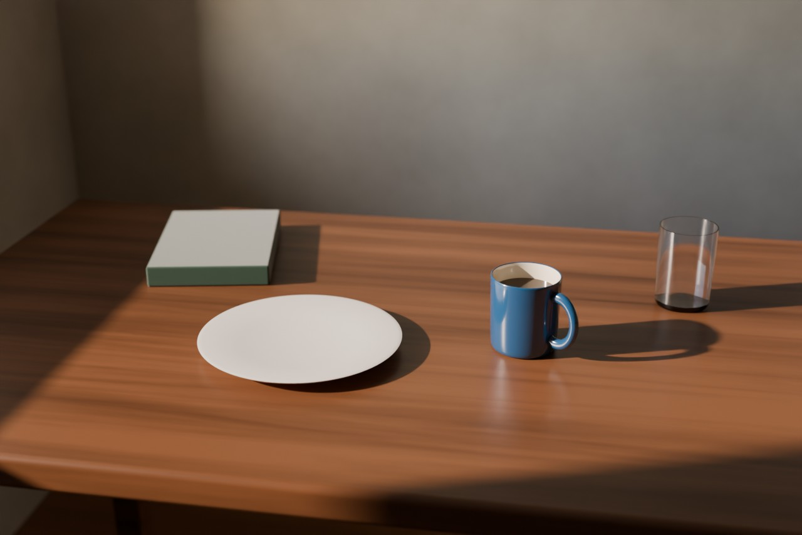
<sub>Window-lit breakfast table — fully generated by the skill's test scenario S06 (Cycles, 256 spp, grey-card metered exposure). The mug was appended from another .blend produced by scenario S01.</sub>

---

## Contents

- [Why this skill](#why-this-skill)
- [Gallery](#gallery)
- [Requirements](#requirements)
- [Installation](#installation) — [Claude Code](#claude-code) · [Claude Desktop](#claude-desktop-app) · [claude.ai](#claudeai-web--desktop-chat) · [Claude Agent SDK](#claude-agent-sdk) · [Claude API](#claude-api-skills-api) · [OpenAI Codex](#openai-codex-cli--ide) · [Gemini CLI](#gemini-cli) · [GitHub Copilot](#github-copilot-vs-code--copilot-cli) · [Cursor](#cursor) · [OpenCode](#opencode) · [Other agents](#other-agents-aider-cline-windsurf-continue-custom)
- [Verify the installation](#verify-the-installation)
- [Usage examples](#usage-examples)
- [Using the tools without an AI](#using-the-tools-without-an-ai)
- [How it works](#how-it-works)
- [Testing](#testing)
- [Compatibility](#compatibility)
- [Troubleshooting](#troubleshooting)
- [Limitations](#limitations)
- [Contributing](#contributing) · [License](#license) · [Bahasa Indonesia](#bahasa-indonesia)

## Why this skill

Most "Blender + AI" setups generate a script, run it, and declare success when it exits without an
error. That proves nothing about the picture. This skill is built around a closed loop:

```
brief -> plan -> build (script) -> validate (numbers) -> preview (images the agent reads) -> fix -> final render -> deliver
```

- **Tested helper library (`bkit`, 17 modules)** — modelling, materials, Geometry Nodes, lighting,
  cameras, rendering, animation, rigging, physics, inspection and validation. Every helper is
  exercised by a test scenario on a real Blender install.
- **Headless runner (`scripts/bk.py`)** — runs Blender in the background, returns structured JSON with
  the failing line on errors, keeps full logs, and **never overwrites your files** (versioned saves).
- **Measured QA** — `validate` checks missing textures, normals, non-manifold geometry, duplicate
  vertices, intersections (with penetration depth), polygon budgets, camera framing, lighting and
  render settings; `imgcheck` checks exposure, clipping and fireflies; `auto_exposure` meters an 18%
  grey card like a photographer.
- **Visual inspection** — labelled multi-view contact sheets (clay / material / wireframe / per-object
  colours) and animation frame strips that the agent reads with its image tools.
- **Version-aware** — a capability probe plus a `compat` layer for API breaks across Blender 3.x / 4.x / 5.x.
- **Knowledge that cost real defects** — 12 reference guides and a troubleshooting catalogue built
  from 28 defects the test suite actually caught (black glass, backdrop edges, IK chains that won't
  bend, mirrored bone rolls, phantom physics tunnelling, washed-out colours, ...).

## Gallery

All images below were produced by the skill's own test scenarios — no manual editing.

| | |
|---|---|
| 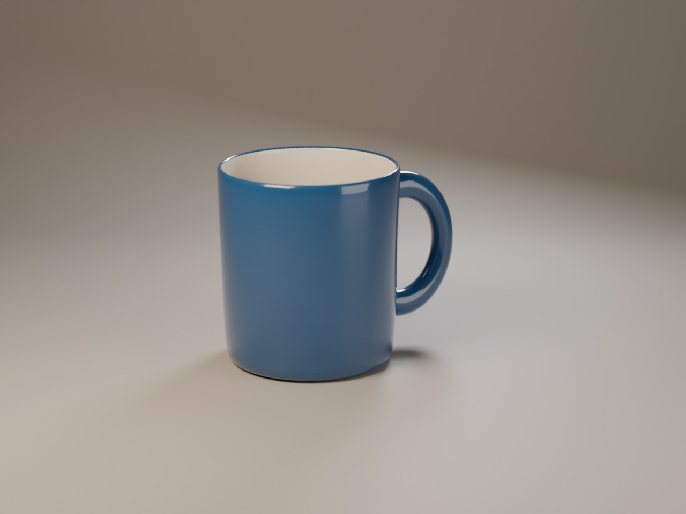 **S01** basic object: lathe-modelled mug, camera-aware cyclorama, three-point rig | 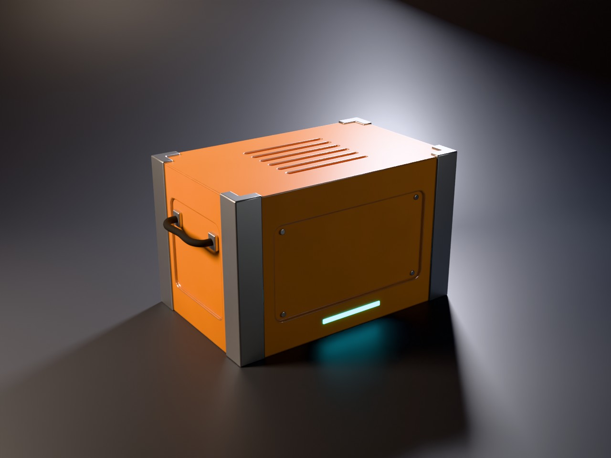 **S02** hard-surface: booleans, bevel/weld/weighted-normal stack, edge-worn paint |
| 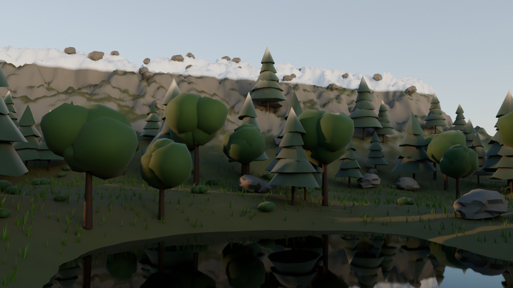 **S03** Geometry Nodes terrain + 5 scatter layers (12.9k instances), lake placed by raycasting | 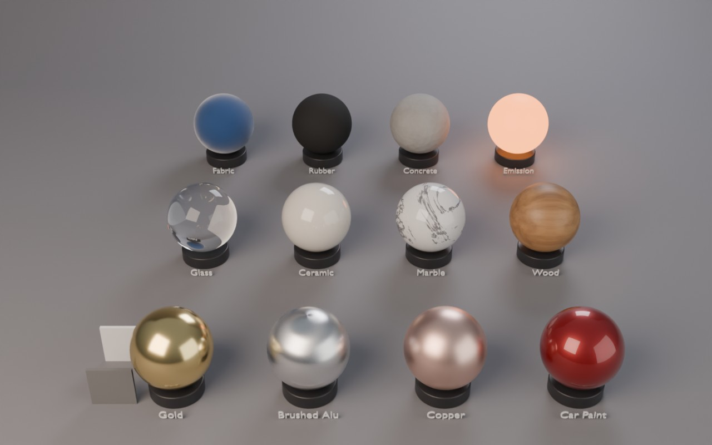 **S04** 12 material presets + grey/white calibration cards |
| 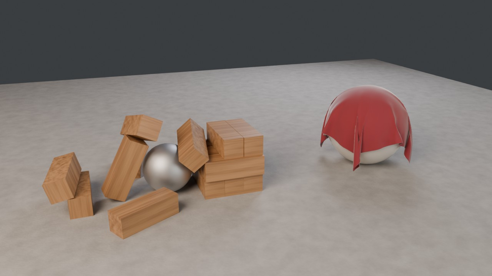 **S09** rigid-body tower hit by a 25 kg ball + cloth drape, checked every frame | 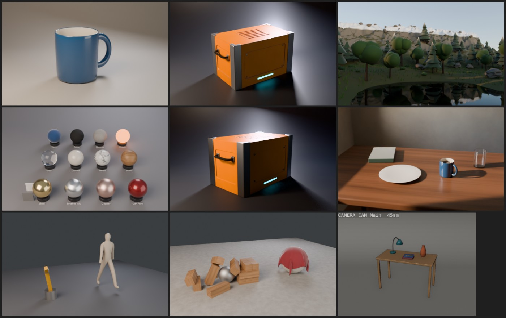 Regression suite overview (all scenarios) |

**S05 cinematic animation** — orbit + dolly, lights-up reveal, pulsing emission, DOF, motion blur (EEVEE, 72 frames → MP4):
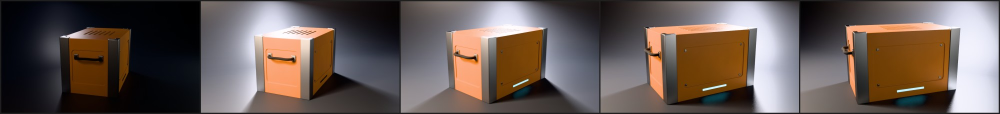

**S08 rigging** — IK robot arm (0.000 m reach error) and an auto-weighted mannequin walk cycle:
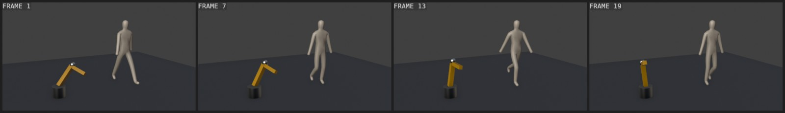

**Why visual QA matters** — same scene under four view transforms (AgX desaturates bright orange, Filmic skews it yellow, Khronos PBR Neutral keeps the product colour), and the A/B test that found why a glass rendered black (smooth shading on a thin wall, not the material):

| 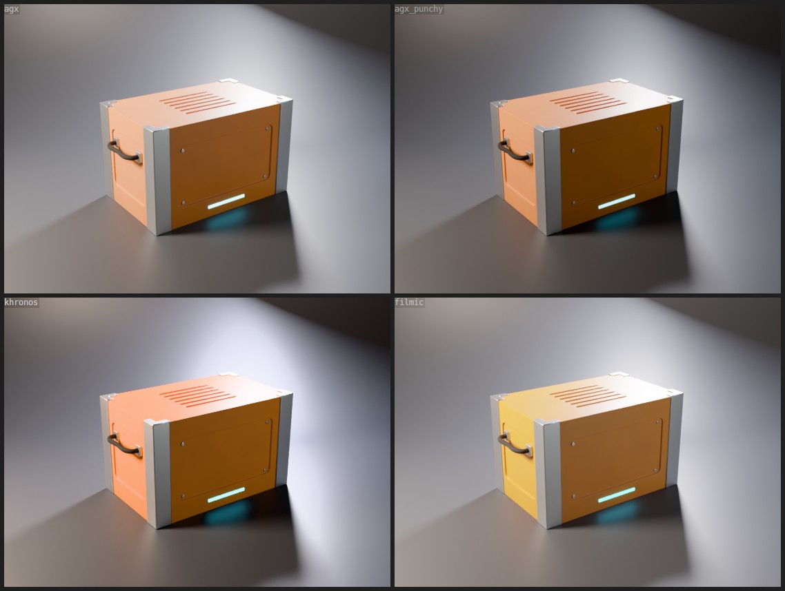 | 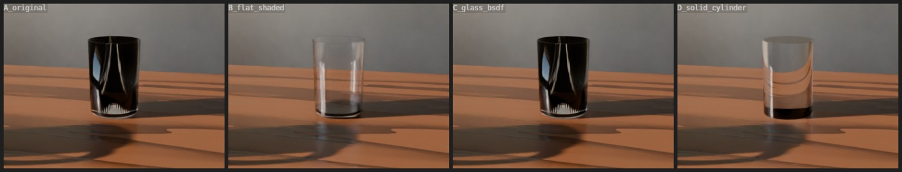 |
|---|---|

## Requirements

| | |
|---|---|
| **Blender** | Installed locally. Tested on **4.5.10 LTS**; other versions run through the `compat` layer (probe first). Found automatically on Windows, macOS and Linux, or set `BLENDER_PATH`. |
| **Python** | 3.8+ on your `PATH` for `scripts/bk.py` (standard library only — Blender brings its own Python for the rest). |
| **Agent** | Any AI agent that can **run shell commands on your machine** gets the full skill. Chat-only environments (claude.ai web, API containers) can read the knowledge and write scripts, but cannot run your Blender. |
| **GPU** | Optional. Cycles works on CPU; EEVEE needs an OpenGL 4.3+ / Vulkan capable GPU. |

### Capability by platform

| Platform | Skill auto-loads | Runs Blender locally | Full loop (build → render → look) |
|---|---|---|---|
| Claude Code (CLI, IDE, Desktop "Code") | yes | yes | **yes** |
| Claude Agent SDK (your own agent) | yes | yes | **yes** |
| OpenAI Codex CLI / IDE extension | yes | yes | **yes** |
| Gemini CLI | yes | yes | **yes** |
| GitHub Copilot (VS Code agent mode, Copilot CLI) | yes | yes | **yes** |
| Cursor (Agent) | yes | yes | **yes** |
| OpenCode | yes | yes | **yes** |
| claude.ai / Claude Desktop chat | yes (upload ZIP) | no (cloud sandbox) | guidance + scripts only |
| Claude API (Skills API + code execution) | yes | no (container) | guidance + scripts only |
| Agents without skill support (Aider, Cline, ...) | via rules/instructions file | yes | yes (manual loading) |

## Installation

The skill is a folder named **`blender-master`** containing `SKILL.md` (the [Agent Skills](https://agentskills.io)
open format). Installing = putting that folder where your agent looks for skills. **Keep the folder
name `blender-master`** — several tools require it to match the `name:` in `SKILL.md`.

> Tip — install once, share everywhere: clone into one place (e.g. `~/.agents/skills/blender-master`)
> and symlink it into each tool's folder:
> ```bash
> ln -s ~/.agents/skills/blender-master ~/.claude/skills/blender-master        # macOS / Linux
> ```
> ```powershell
> New-Item -ItemType Junction -Path "$HOME\.claude\skills\blender-master" -Target "$HOME\.agents\skills\blender-master"   # Windows, no admin needed
> ```

### Claude Code

Personal (all projects):
```bash
git clone https://github.com/Ridwan1711/blender-master.git ~/.claude/skills/blender-master
```
```powershell
git clone https://github.com/Ridwan1711/blender-master.git "$HOME\.claude\skills\blender-master"
```
Project-only (commit it with your repo so your team gets it):
```bash
git clone https://github.com/Ridwan1711/blender-master.git .claude/skills/blender-master
```
Start a new Claude Code session; the skill loads automatically for Blender tasks (or ask for it by name).
Update later with `git -C ~/.claude/skills/blender-master pull`.

### Claude Desktop app

The **Code** tab of the Claude Desktop app is Claude Code: install exactly as for
[Claude Code](#claude-code) (personal folder `~/.claude/skills/`). For the **chat** tab, see
[claude.ai](#claudeai-web--desktop-chat).

### claude.ai (web & desktop chat)

1. Build the upload ZIP (the archive must contain the `blender-master/` folder at its top level):
   ```bash
   git clone https://github.com/Ridwan1711/blender-master.git
   python blender-master/scripts/package_skill.py      # -> blender-master/dist/blender-master.zip
   ```
2. In **Settings → Capabilities**, make sure code execution / *Create and edit files* is enabled.
3. Go to **Customize → Skills → + → Create skill → Upload a skill**, choose `blender-master.zip`.

Limitation: claude.ai runs skills in a cloud sandbox **without Blender**, so Claude can plan, explain
and write `bkit`/bpy scripts for you to run locally (`python scripts/bk.py run your_script.py`), but
it cannot render or inspect your scenes itself. Use a local agent for the full loop.

### Claude Agent SDK

The SDK loads filesystem skills from the same folders as Claude Code. Install into
`~/.claude/skills/` (user) or `<project>/.claude/skills/` (project), then enable skills when you
create the agent:

```python
from claude_agent_sdk import query, ClaudeAgentOptions

options = ClaudeAgentOptions(
    setting_sources=["user", "project"],          # load skills from ~/.claude and ./.claude
    allowed_tools=["Skill", "Bash", "Read", "Write", "Edit"],
)
async for msg in query(prompt="Model a ceramic mug and render a product shot", options=options):
    print(msg)
```
(TypeScript: `settingSources: ["user", "project"]`, `allowedTools: ["Skill", ...]`.) The agent needs
`Bash` to run Blender and `Read` to look at renders.

### Claude API (Skills API)

Custom skills can be uploaded with the Skills API (`/v1/skills`) and attached to the code execution
container. As with claude.ai, that container has no Blender — useful for script generation and
review, not for rendering. Upload the skill files (multipart `files[]`, or build the folder with
`package_skill.py`) as described in the
[Skills API reference](https://platform.claude.com/docs/en/api/beta/skills/create).

### OpenAI Codex (CLI & IDE)

Personal:
```bash
git clone https://github.com/Ridwan1711/blender-master.git ~/.codex/skills/blender-master
```
```powershell
git clone https://github.com/Ridwan1711/blender-master.git "$HOME\.codex\skills\blender-master"
```
Project: clone into `.agents/skills/blender-master` in your repository (some Codex docs use
`.codex/skills/`; check your version). Restart Codex, then type `/skills` or `$` to see/invoke it.

### Gemini CLI

Personal:
```bash
git clone https://github.com/Ridwan1711/blender-master.git ~/.gemini/skills/blender-master
```
or link an existing clone: `gemini skills link /path/to/blender-master`.
Project: `.gemini/skills/blender-master` (or `.agents/skills/`). Check with `gemini skills list`
or `/skills list` in a session. Gemini asks for permission before activating a skill.

### GitHub Copilot (VS Code / Copilot CLI)

Project (shared with your team): `.github/skills/blender-master/`
```bash
git clone https://github.com/Ridwan1711/blender-master.git .github/skills/blender-master
```
Personal: `~/.copilot/skills/blender-master/` (VS Code also reads `~/.claude/skills/`).
Use **agent mode** so Copilot can run the terminal commands. Extra locations can be added with the
`chat.skillsLocations` setting. Agent Skills support depends on your VS Code / Copilot version — see
the [VS Code Agent Skills docs](https://code.visualstudio.com/docs/agent-customization/agent-skills).

### Cursor

Project: `.cursor/skills/blender-master/` (also `.agents/skills/`).
```bash
git clone https://github.com/Ridwan1711/blender-master.git .cursor/skills/blender-master
```
Personal: Cursor also loads `~/.claude/skills/` and `~/.codex/skills/`, so a
[Claude Code](#claude-code) or [Codex](#openai-codex-cli--ide) install works in Cursor too.
Invoke with `/blender-master` in Agent chat, or let Cursor pick it automatically.

### OpenCode

Personal: `~/.config/opencode/skills/blender-master/` · Project: `.opencode/skills/blender-master/`
```bash
git clone https://github.com/Ridwan1711/blender-master.git ~/.config/opencode/skills/blender-master
```
OpenCode also reads `.claude/skills/` and `.agents/skills/`.

### Other agents (Aider, Cline, Windsurf, Continue, custom)

Agents without a skill system can still use everything — the tools are plain scripts:

1. Clone the repo anywhere, e.g. `~/tools/blender-master`.
2. Add `SKILL.md` as an always-on instruction / rules file, for example:
   - **Aider:** `aider --read ~/tools/blender-master/SKILL.md`
   - **Cline / Roo:** reference it from `.clinerules`
   - **Windsurf:** reference it from `.windsurfrules` / workspace rules
   - **Custom agent / system prompt:** paste `SKILL.md` and tell the model where the folder lives.
3. Tell the agent: *"SKILL_DIR is ~/tools/blender-master"*. It reads `references/*.md` on demand.

## Verify the installation

1. Check that Blender is reachable (from any terminal):
   ```bash
   python ~/.claude/skills/blender-master/scripts/bk.py which
   python ~/.claude/skills/blender-master/scripts/bk.py probe
   ```
   `probe` prints your Blender version, render engines, GPU devices and supported features.
2. Ask your agent: *"Which skills do you have?"* (or `/skills` in Codex/Gemini/OpenCode, `/` in Cursor).
3. Optional full self-test (≈2–3 min): `python <skill>/tests/run_tests.py --quick`, then open
   `tests/output/run/overview.png`.

## Usage examples

Just describe what you want — the agent follows the skill's production loop:

- *"Model a ceramic coffee mug and render a studio product shot, 1920×1080."*
- *"Create a sci-fi cargo crate with panel details and worn paint, then export it as GLB."*
- *"Generate a procedural forest valley with a lake at golden hour. Give me seed 7 and seed 12."*
- *"Open `scene.blend`, audit it for problems and fix what you can — save as a new file."*
- *"Animate a 4-second orbit around my product and render an MP4."*
- *"Rig this character and make a walk cycle; show me frames 1, 6, 12, 18."*
- *"Drop 20 boxes on a ramp with rigid-body physics and bake it."*

What you get back: the `.blend` (never overwriting yours), renders, validation score, measured facts
(triangles, render time, exposure), and an honest list of what was and wasn't verified.

## Using the tools without an AI

```bash
B="python scripts/bk.py"
$B probe                                              # what does this Blender support?
$B run build.py --save out/scene.blend [-- args]      # run a build script with bkit available
$B inspect scene.blend --health                       # scene report + mesh health
$B validate scene.blend --tier hero                   # QA rules -> issues + score
$B preview scene.blend --out out/preview --mode wire  # labelled multi-view contact sheet
$B render scene.blend --out out/shot.png --quality final
$B render scene.blend --out out/f/f_ --frames 1-96 --video out/shot.mp4
$B imgcheck out/shot.png                              # exposure / clipping / noise
python scripts/pipeline.py examples/spec_desk.json --out out/desk   # JSON spec -> scene -> QA -> render -> GLB
```

A build script is ordinary Python using `bkit`:
```python
from bkit import scene as S, mesh as M, materials as MT, lighting as L, camera as C, render as R
S.new_scene()
body = M.box("GEO_Body", (0.8, 0.5, 0.5), origin="BOTTOM")
M.hard_surface_finish(body, bevel_width=0.003)
MT.assign(body, MT.painted_metal("MAT_Paint", MT.hex_color("#D9822B")))
body["bk_subject"] = True
cam = C.add("CAM_Main", lens=50); C.frame(cam, [body], azimuth=-35, elevation=20)
L.studio_backdrop(cam, [body]); L.three_point([body], style="product")
R.configure(engine="CYCLES", quality="draft", resolution=(1280, 960))
```

## How it works

```
SKILL.md            orchestrator: production loop, hard rules, routing table, definition of done
references/         12 guides loaded on demand (modeling, materials, geometry-nodes, lighting-camera,
                    rendering, animation-rigging, physics, scene-performance, python-api,
                    compatibility, workflow-qa, troubleshooting)
scripts/bk.py       headless runner + CLI (stdlib only)
scripts/bkit/       helper library imported inside Blender
scripts/*.py        inspect, validate, preview, render, imgcheck, build_from_spec, export, pipeline
examples/           declarative spec + which scenario to start from
tests/              scenarios s00-s09, run_tests.py, TESTING.md (method, results, defect log)
```
Details: [ARCHITECTURE.md](ARCHITECTURE.md).

## Testing

`tests/run_tests.py` builds every scenario in a fresh Blender process, validates it, runs
scenario-specific numeric assertions, renders, checks exposure, and tiles all renders into an
overview image for visual review.

| ID | Scenario | Key measured result |
|---|---|---|
| s00 | API smoke test | 16/16 helper checks incl. intersection guard cases |
| s01 | Basic object (mug) | validation 100 |
| s02 | Complex hard-surface (crate) | no doubles / degenerate faces / intersections |
| s03 | Procedural environment | 12.9k instances, 810k tris, 40 s Cycles render |
| s04 | Material-rich scene | grey card 0.455 vs 0.459 target |
| s05 | Cinematic animation | 72 frames, no camera pops, MP4 verified |
| s06 | Photorealistic render | metered exposure, no clipping/fireflies |
| s07 | Automated project (spec pipeline) | GLB re-import triangle count matches |
| s08 | Rigging & character animation | IK error 0.000 m, 0 unweighted vertices |
| s09 | Physics (rigid + cloth) | deepest overlap 0.16 mm, no cloth spikes |

Latest run: **10/10 passed** (quick mode, 124 s) on Windows 11, Blender 4.5.10 LTS, Ryzen 7 1700,
GTX 750 Ti. Full method, timings and the defect log: [tests/TESTING.md](tests/TESTING.md).

## Compatibility

| | Status |
|---|---|
| Blender 4.5 LTS | tested (all scenarios) |
| Blender 4.2 – 4.4 | expected to work (compat layer: EEVEE Next ids, Principled v2, slotted actions) — run the test suite |
| Blender 5.x | compat paths follow the release notes (EEVEE id, layered actions, compositor node groups) — **untested** |
| Blender 3.6 | partial (legacy socket names / auto smooth handled) — untested |
| Windows / macOS / Linux | runner finds Blender on all three; tested on Windows |

See [references/compatibility.md](references/compatibility.md) for the full API matrix.

## Troubleshooting

| Problem | Fix |
|---|---|
| Agent doesn't see the skill | Folder must be named `blender-master` and contain `SKILL.md` (uppercase); check the path for your tool above; restart the tool / start a new session. |
| `Blender not found` | Set `BLENDER_PATH` to the executable (e.g. `C:\Program Files\Blender Foundation\Blender 4.5\blender.exe`, `/Applications/Blender.app/Contents/MacOS/Blender`). |
| `python` not found | Install Python 3.8+ or call `python3` / `py`. |
| claude.ai upload rejected | Use `scripts/package_skill.py` (folder must be the ZIP's top-level entry; description ≤ 200 chars). |
| EEVEE first render is slow | Shader compilation on first use (26–38 s on an old GPU); later frames are fast. |
| GPU out of memory | `BKIT_DEVICE=CPU` environment variable, or lower resolution/samples. |
| Anything else | [references/troubleshooting.md](references/troubleshooting.md) (symptom → cause → fix). |

## Limitations

- Needs a local Blender and an agent that can run shell commands for the full loop.
- Procedural stand-in assets (trees, rocks, grass) are stylised; photoreal organics need real assets.
- Rigify generation, fluids, smoke, hair and simulation zones have reference notes but no tested helpers yet.
- Only Blender 4.5 has been tested end-to-end; other versions should run the test suite first.
- The agent's visual judgement is part of QA — the skill produces the images, the model must look at them.

## Contributing

Issues and pull requests are welcome. Before submitting:

1. `python tests/run_tests.py --quick` must pass, and look at `tests/output/run/overview.png`.
2. New helpers need a test (a scenario or a case in `tests/scenarios/s00_api_smoke.py`).
3. Found a Blender gotcha? Add it to `references/troubleshooting.md` and the defect log in `tests/TESTING.md`.
4. Testing on another Blender version or OS is especially valuable — please report the probe output.

## License

[MIT](LICENSE)

---

## Bahasa Indonesia

**Blender Master** adalah *skill* (format Agent Skills / `SKILL.md`) yang membuat agen AI bisa
mengoperasikan Blender secara profesional: modeling, material, Geometry Nodes, lighting, render
Cycles/EEVEE, animasi, rigging, fisika, validasi kualitas, dan ekspor — lalu **memeriksa hasil
render-nya sendiri** sebelum menyatakan selesai.

**Syarat:** Blender terpasang di komputer (diuji di 4.5 LTS), Python 3.8+, dan agen AI yang bisa
menjalankan perintah terminal.

**Cara pasang cepat** — clone ke folder skill milik aplikasi AI Anda, nama folder harus `blender-master`:

| Aplikasi | Folder pribadi (semua proyek) |
|---|---|
| Claude Code / Claude Desktop (tab Code) | `~/.claude/skills/blender-master` |
| OpenAI Codex | `~/.codex/skills/blender-master` |
| Gemini CLI | `~/.gemini/skills/blender-master` |
| GitHub Copilot | `~/.copilot/skills/blender-master` (atau `.github/skills/` per proyek) |
| Cursor | `.cursor/skills/blender-master` (per proyek) atau pakai folder Claude/Codex |
| OpenCode | `~/.config/opencode/skills/blender-master` |

Contoh (Windows PowerShell, Claude Code):
```powershell
git clone https://github.com/Ridwan1711/blender-master.git "$HOME\.claude\skills\blender-master"
python "$HOME\.claude\skills\blender-master\scripts\bk.py" probe
```

**claude.ai (web/desktop chat):** jalankan `python scripts/package_skill.py`, lalu unggah
`dist/blender-master.zip` di **Customize → Skills → + → Create skill → Upload a skill**
(aktifkan dulu eksekusi kode di **Settings → Capabilities**). Catatan: di claude.ai tidak ada Blender,
jadi Claude hanya bisa membuatkan skrip dan panduan, tidak bisa me-render.

Setelah terpasang, cukup minta dalam bahasa biasa, misalnya: *"Buatkan model mug keramik dan render
foto produk studio"* atau *"Periksa file scene.blend saya dan perbaiki masalahnya, simpan sebagai file baru."*
